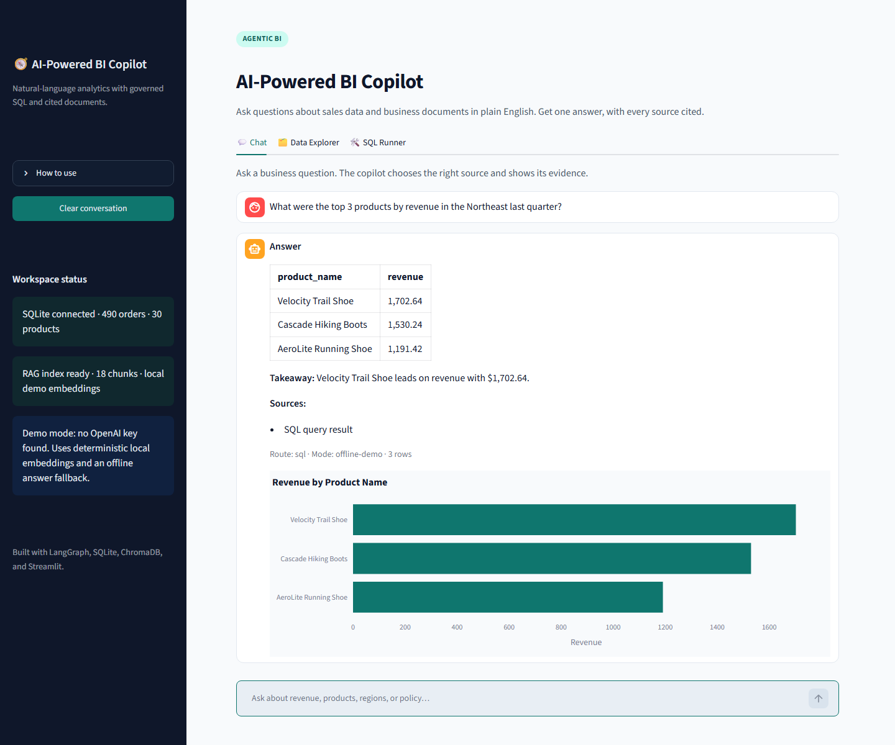

# BI Copilot: Natural language interface for SQL + business documents.

Ask a business question in plain English. The agent routes it to a governed SQL
warehouse, a cited document index, or both — then returns one answer with sources
and a chart when the result is numeric.



*Offline demo mode shown: a SQL-routed question returns a cited table and an
auto-generated Plotly chart.*


[View the source on GitHub](https://github.com/Skpkush/bi-copilot).

## Problem

Business stakeholders wait hours for simple data answers; analysts spend 60% of
their time on repetitive queries. The answer is usually split across a warehouse
and a pile of policy or performance documents, so even a correct number arrives
without context — and a policy answer arrives without evidence.

## Solution

An agentic AI copilot that routes questions to SQL or RAG, with citations. A
LangGraph supervisor selects the minimum set of specialists, a read-only SQL tool
computes metrics from SQLite, a ChromaDB retriever finds the relevant business
text, and GPT-4o-mini synthesizes a concise answer. Every response ends with a
**Sources** section.

## What it does

- **Plain-English chat** with routing to SQL, documents, both, or no source.
- **Governed SQL**: one `SELECT`/CTE only, forbidden-keyword checks, multi-statement
  rejection, a read-only SQLite connection, and a hard row cap.
- **RAG with filenames**: overlapping chunks, source metadata, top-k retrieval, and
  inline document citations.
- **Automatic bar charts** for numeric query results.
- **Data Explorer** for the cleaned `orders`, `products`, and `customers` tables.
- **SQL Runner** with the same safety layer as the agent.
- **Offline demo mode**: with no API key, deterministic local embeddings and an
  extractive answer fallback keep the entire project runnable for review.

## Architecture

```text
                         ┌─────────────────────────────────────┐
                         │           Streamlit UI              │
                         │  Chat · Data Explorer · SQL Runner  │
                         └──────────────────┬──────────────────┘
                                            │ ask(question)
                         ┌──────────────────▼──────────────────┐
                         │        LangGraph supervisor         │
                         │   route: sql | docs | both | none   │
                         └───────────┬─────────────────┬───────┘
                                     │                 │
                    ┌────────────────▼───┐   ┌─────────▼────────────┐
                    │  sql_query tool    │   │ document_search tool │
                    │  validate + limit  │   │ ChromaDB top-k +     │
                    │  read-only SQLite  │   │ source metadata      │
                    └────────────────┬───┘   └─────────┬────────────┘
                                     │                 │
                         ┌───────────▼─────────────────▼───────────┐
                         │   GPT-4o-mini synthesis (when key set)  │
                         │   inline citations + Sources section    │
                         └──────────────────────────────────────────┘
```

**Flow:** Streamlit → LangGraph Agent → SQLite + ChromaDB → LLM. The LLM never
executes SQL directly: it proposes a query, the guard validates it, and the
read-only engine executes it.

## Tech stack

| Layer | Choice | Role |
|---|---|---|
| UI | Streamlit 1.x | Chat, tabs, dataframes, Plotly |
| Orchestration | LangGraph | Stateful supervisor/specialist workflow |
| LLM | OpenAI GPT-4o-mini | Routing, SQL generation, answer synthesis |
| Structured data | SQLite + SQLAlchemy | Cleaned sales warehouse |
| Unstructured data | ChromaDB | Vector index over business documents |
| RAG embeddings | OpenAI `text-embedding-3-small` | Semantic retrieval in production |
| Data cleaning | Pandas | Dates, nulls, duplicates, casing |
| Charts | Plotly | Bar charts from numeric results |

## How the agent works

1. **Supervisor** reads the question and picks `sql`, `docs`, `both`, or `none`.
   Numeric/trend questions go to SQL; policy/qualitative questions go to documents;
   causal questions that need both are routed to both.
2. **`sql_query`** gets the schema from LangChain `SQLDatabase`, asks the LLM for a
   single SQLite `SELECT`, validates it against the guard, then executes it through
   a physical read-only connection. The tool returns a Markdown table plus rows for
   the chart layer.
3. **`document_search`** queries ChromaDB for the top four chunks and returns each
   chunk with its filename. The answer cites the filename inline.
4. **Synthesis** combines the evidence, notes limitations (for example, shipping
   invoices are not stored in the warehouse), and the application appends a
   canonical **Sources:** section.

If `OPENAI_API_KEY` is missing, the supervisor uses deterministic intent rules, the
SQL specialist uses safe demo queries, and the answer is an extractive summary of
the retrieved evidence. The offline index uses a local hashing embedding model so
ChromaDB retrieval and citations still work. Rebuild the index after adding a key
to switch to OpenAI embeddings.

## Data and cleaning

`src/generate_data.py` writes three deliberately messy raw CSVs. `src/load_data.py`
cleans them and loads SQLite.

| Dataset | Raw rows | Intentional issues | Cleaning result |
|---|---:|---|---|
| `orders.csv` | 500 | 25 null `unit_price`, 25 null `region`, mixed date formats, 10 duplicated IDs with later timestamps | 490 unique orders, ISO dates, latest duplicate kept |
| `products.csv` | 30 | 7 trailing-space names, one negative `cost_price` | trimmed names, negative replaced with median cost `$34.50` |
| `customers.csv` | 200 | 6 null emails (3%), 12 loyalty-tier spellings | ISO signup dates, title-cased tiers |

Revenue is defined as `quantity * unit_price * (1 - discount)`. `Cancelled` and
`Returned` orders are excluded from booked revenue. The sample warehouse spans
2026-01-01 through 2026-09-30, with 2026-Q3 as the latest complete quarter.

## Repository layout

```text
bi-copilot/
├── app.py                  # Streamlit UI (3 tabs)
├── requirements.txt
├── .env.example
├── README.md
├── LINKEDIN_POST.md
├── shots/app-chat-preview.png
├── data/                   # raw CSVs, business.db, generated Chroma index
├── docs/                   # RAG source documents
│   ├── sales_policy.txt
│   ├── q3_summary.txt
│   └── product_notes.txt
├── src/
│   ├── generate_data.py    # messy data generator
│   ├── load_data.py        # cleaning + SQLite load
│   ├── build_rag.py        # Chroma indexing + embeddings
│   ├── sql_guard.py        # validation + read-only execution
│   ├── agent.py            # LangGraph supervisor + tools
│   └── config.py
└── tests/
    ├── test_sql_guard.py
    └── test_agent.py
```

## How to run

Prerequisites: Python 3.11+ and an OpenAI API key for full LLM mode. The app also
runs without a key in offline demo mode.

### 1. Install

```bash
cd bi-copilot
python -m venv .venv
# Windows
.venv\Scripts\activate
# macOS/Linux
# source .venv/bin/activate

pip install -r requirements.txt
```

### 2. Configure the model

```bash
# Windows
copy .env.example .env
# macOS/Linux
# cp .env.example .env
```

Set `OPENAI_API_KEY` in `.env`. To demo without a key, leave it unset or set
`BI_COPILOT_OFFLINE=1`.

### 3. Build the warehouse and index

```bash
python -m src.generate_data
python -m src.load_data
python -m src.build_rag
```

After adding an API key later, rebuild the vector index so it uses OpenAI
embeddings:

```bash
python -m src.build_rag
```

### 4. Start the app

```bash
streamlit run app.py
```

Open **http://localhost:8501**. The app is configured for port `8501`.

### Local smoke test

```bash
python -m unittest discover -s tests -v
```

## Sample Q&A

These outputs were captured from the local app with no `OPENAI_API_KEY` present, so
they show the deterministic **offline demo path** (local Chroma embeddings and
extractive synthesis). With a key configured, the same routes use GPT-4o-mini for
generation; the SQL values and document citations come from the same sources.

### 1. "What were the top 3 products by revenue in the Northeast last quarter?"

Route: `sql` · 3 rows · chart: bar chart of revenue by product

```text
**Answer**
| product_name | revenue |
| --- | --- |
| Velocity Trail Shoe | 1,702.64 |
| Cascade Hiking Boots | 1,530.24 |
| AeroLite Running Shoe | 1,191.42 |

**Takeaway:** Velocity Trail Shoe leads on revenue with $1,702.64.

**Sources:**
- SQL query result
```

### 2. "What is the discount policy for orders above $1000?"

Route: `docs` · source: `sales_policy.txt`

```text
**Answer**
**sales_policy.txt**

> Orders with a merchandise subtotal above $1,000:
> - The standard self-service discount cap is 10%.
> - Discounts from 10.1% through 15% require Sales Manager approval entered in
>   the CRM before the quote is sent.
> - Discounts above 15% require manager and VP of Sales approval, a margin
>   analysis, and a defined renewal or volume commitment.
> - Orders above $1,000 cannot be split into smaller orders to avoid the approval
>   threshold. Revenue Operations audits split-order patterns monthly.

The policy and lifecycle documents are the authoritative source for this question.

**Sources:**
- sales_policy.txt
```

### 3. "Why did profit margins drop in Q3, and which region was most affected?"

Route: `both` · SQL + `q3_summary.txt` · chart: regional revenue exposure

```text
**Answer**
The Q3 business summary attributes the margin decline to higher shipping costs in
the Northeast, making the Northeast the most affected region. Warehouse data is
consistent with that exposure: Northeast leads on revenue with $11,586.08.
Shipping cost is not stored at order level, so SQL can show revenue exposure but
cannot independently quantify the 8% freight impact.

**Warehouse result**
| region | orders | revenue | avg_order_value | avg_discount_pct |
| --- | --- | --- | --- | --- |
| Northeast | 42 | 11,586.08 | 275.86 | 9.30 |
| Southeast | 56 | 9,094.02 | 162.39 | 8.30 |
| Midwest | 26 | 4,181.30 | 160.82 | 9.20 |
| Southwest | 25 | 3,401.05 | 136.04 | 8.20 |
| West | 20 | 3,037.99 | 151.90 | 6.30 |

**Document evidence**
**q3_summary.txt**

> Profit margins dropped 8% due to increased shipping costs in the Northeast.
> The Northeast carried the highest revenue exposure and the sharpest increase in
> cost-to-serve, so it was the region most affected by the margin decline. Carrier
> capacity constraints raised last-mile surcharges, while the region's 3% price
> index was not enough to offset the increase. The company absorbed most of the
> surcharge rather than passing it through mid-quarter.

**Sources:**
- SQL query result
- q3_summary.txt
```

The third answer deliberately distinguishes what the warehouse can prove (regional
revenue exposure) from what the finance-authored summary asserts (an 8% freight
impact). Shipping invoices are not in the sample warehouse.

## Business impact

**Reduced time-to-insight from hours to seconds.** A stakeholder can ask a
follow-up without filing a ticket, and every answer keeps its evidence attached —
so analysts spend less time re-running the same query and more time on decisions.

## What I learned

- **Agentic workflows**: a supervisor plus narrow specialists is easier to govern
  than a single tool-using prompt. Explicit routes make failures observable.
- **RAG**: chunking and source metadata matter as much as the embedding model; a
  citation is only useful if it points to a filename a human can open.
- **Data cleaning**: date ambiguity, trailing spaces, duplicate business keys, and
  negative costs break joins and aggregates in ways that look like model errors.
- **Prompt engineering**: schemas, metric definitions, and date boundaries belong
  in the prompt; output validation belongs in code.
- **Governed SQL**: never trust generated SQL. Layer allow-listing, read-only
  credentials, and row caps instead of relying on a prompt to behave.

## Security and limitations

- The SQL guard permits one `SELECT`/CTE, blocks DDL/DML and stacked statements,
  and the SQLite connection uses `mode=ro` plus `PRAGMA query_only`.
- The SQL Runner has a 500-row cap; the agent tool has a 200-row cap.
- This is a portfolio demo, not a multi-tenant production service: there is no
  authentication, row-level security, audit log, or secret manager yet.
- Shipping cost is not in the order warehouse. The Q3 summary is the authoritative
  qualitative source for the freight-driven margin decline; SQL can show regional
  exposure but cannot quantify the invoice-level cause.
- The offline fallback is intentionally extractive. Set an OpenAI key for the
  full generative experience.

## Deploy

For Streamlit Community Cloud, push the repository, set `OPENAI_API_KEY` in the
app secrets, and use `app.py` as the entry point. The generated database and Chroma
index are gitignored by default; for a one-click hosted demo, either commit those
artifacts (roughly 1.3 MB) or run the three setup commands in a pre-start step.
For a production deployment, add authentication, a managed Postgres warehouse, a
hosted vector store, and an audit trail.

## Launch post

The LinkedIn launch copy is in [`LINKEDIN_POST.md`](./LINKEDIN_POST.md).
